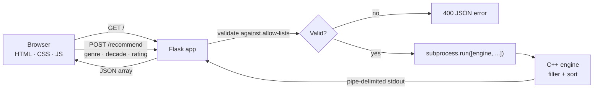

# 🎬 CineMatch

**A movie discovery app with a C++ recommendation engine and a Flask-powered interface.**

CineMatch pairs a hand-curated catalogue of 77 films across 9 genres with a small, dependency-free
C++ engine that filters and ranks recommendations. The Flask layer validates every request, runs the
engine in an isolated subprocess, and returns clean JSON that drives a fully responsive, single-page
front end.

[](https://github.com/Shivam81137/movie-rs/actions/workflows/ci.yml)
[](https://www.python.org/)
[](https://flask.palletsprojects.com/)
[](https://isocpp.org/)
[](LICENSE)

---

## Table of contents

- [Quick start](#quick-start)
- [Overview](#overview)
- [Features](#features)
- [Architecture](#architecture)
- [Tech stack](#tech-stack)
- [Project structure](#project-structure)
- [Getting started](#getting-started)
- [Configuration](#configuration)
- [API reference](#api-reference)
- [Security](#security)
- [Development](#development)
- [Troubleshooting](#troubleshooting)
- [Roadmap](#roadmap)
- [Contributing](#contributing)
- [License](#license)

---

## Quick start

```bash
git clone https://github.com/Shivam81137/movie-rs.git
cd movie-rs

python -m venv .venv
# Windows: .\.venv\Scripts\Activate.ps1
# macOS/Linux: source .venv/bin/activate

python -m pip install -r requirements.txt
make build          # or: g++ -O2 -std=c++17 engine.cpp -o engine(.exe)
python app.py
```

Open <http://127.0.0.1:5000>. Full platform-specific instructions are in
[Getting started](#getting-started).

## Overview

CineMatch is a two-part application:

1. **`engine.cpp`** — a self-contained C++17 program that holds the movie catalogue and applies
   genre, decade, and minimum-rating filters. It prints one pipe-delimited record per movie.
2. **`app.py`** — a Flask app that serves the UI, validates query parameters against allow-lists,
   invokes the engine with an argument array (never a shell), and converts its output to JSON.

The result is a fast, dependency-light app that demonstrates clean interop between a Python web
layer and a native C++ core.

## Features

| Area | What you get |
| --- | --- |
| **Discovery** | Browse 77 curated films across 9 genres, ranked by rating |
| **Filtering** | Genre, decade (1980s–2020s), and minimum rating |
| **Search** | Live title autocomplete, plus client-side title filtering |
| **Spotlight** | Auto-rotating hero carousel for the top results |
| **Watchlist** | Save films locally, with badges and a dedicated watchlist view |
| **Personal ratings** | Star films from 1–5; saved in the browser |
| **Mood picker** | One-click genre shortcuts (Thrilling, Heartwarming, Mind-Bending, …) |
| **Extras** | Recently viewed strip, genre statistics, sorting, command palette, keyboard shortcuts |
| **Privacy** | Watchlist, ratings, and history never leave the browser (`localStorage`) |
| **Responsive UI** | Mobile-first layout with reduced-motion and print styles |

## Architecture



**Why a subprocess?** The engine stays separate from the web process: it receives a fixed argument
array, runs with a hard timeout, and its output is parsed defensively. This keeps the C++ core simple
and prevents a native crash from taking down the web app.

## Tech stack

| Layer | Technology |
| --- | --- |
| Front end | HTML5, modern CSS, vanilla JavaScript (no build step) |
| Web server | Python 3.10+, Flask 3.1 |
| Recommendation engine | C++17 (standard library only) |
| Tooling | GNU Make, GitHub Actions |

## Project structure

```text
movie-rs/
├── app.py                 # Flask routes, validation, subprocess bridge
├── engine.cpp             # C++17 recommendation engine and movie catalogue
├── templates/
│   └── index.html         # Single-page UI (HTML + CSS + JS)
├── requirements.txt       # Python dependencies
├── Makefile               # Build/run/clean helpers
├── .github/
│   └── workflows/
│       └── ci.yml         # Build engine + smoke-test the API
├── .gitignore
├── SECURITY.md
├── LICENSE
└── README.md
```

## Getting started

### Prerequisites

- **Python 3.10+** with `pip`
- **A C++17 compiler** — `g++` (MinGW-w64 on Windows) or `clang++`
- **GNU Make** *(optional)* — on Windows install it as `mingw32-make` via MinGW/MSYS2

Verify your toolchain:

```bash
python --version
g++ --version
make --version        # or mingw32-make --version
```

### 1. Clone the repository

```bash
git clone https://github.com/Shivam81137/movie-rs.git
cd movie-rs
```

### 2. Create a virtual environment

**Windows (PowerShell)**

```powershell
python -m venv .venv
.\.venv\Scripts\Activate.ps1
```

**macOS / Linux**

```bash
python3 -m venv .venv
source .venv/bin/activate
```

### 3. Install dependencies

```bash
python -m pip install --upgrade pip
python -m pip install -r requirements.txt
```

### 4. Build the engine

With Make:

```bash
make build
```

Or directly:

```bash
# Windows
g++ -O2 -std=c++17 -Wall -Wextra -pedantic engine.cpp -o engine.exe

# macOS / Linux
g++ -O2 -std=c++17 -Wall -Wextra -pedantic engine.cpp -o engine
```

Try it on its own:

```bash
# Windows
.\engine.exe "Sci-Fi" 2010s 8

# macOS / Linux
./engine "Sci-Fi" 2010s 8
```

### 5. Run the app

```bash
python app.py
```

Open <http://127.0.0.1:5000>.

> The app looks for the compiled engine at `./engine` (`./engine.exe` on Windows), then
> `./output/`, then `./bin/`. Set `CINEMATCH_ENGINE` to use a custom path.

## Configuration

Configuration is environment-based; there are no secrets in the repository.

| Variable | Default | Description |
| --- | --- | --- |
| `CINEMATCH_HOST` | `127.0.0.1` | Interface to bind. Use `0.0.0.0` only inside a trusted network/container. |
| `CINEMATCH_PORT` | `5000` | HTTP port (1–65535). |
| `FLASK_DEBUG` | `false` | Enables Flask's debugger. **Never enable in production.** |
| `CINEMATCH_ENGINE` | auto-detected | Absolute or relative path to the compiled engine. |

Example:

```powershell
$env:CINEMATCH_PORT = "8080"
$env:FLASK_DEBUG = "false"
python app.py
```

For production, put a WSGI server and TLS-terminating reverse proxy in front of the app:

```bash
python -m pip install waitress
waitress-serve --listen=127.0.0.1:8000 app:app
```

## API reference

### `GET /`

Serves the single-page UI.

### `GET /healthz`

Liveness probe that also reports whether the engine binary is present.

```json
{ "status": "ok", "engine": true }
```

### `GET /autocomplete?q=<query>`

Returns up to 10 matching movie titles.

| Parameter | Required | Notes |
| --- | --- | --- |
| `q` | yes | Case-insensitive substring, max 64 characters. Empty/oversized input returns `[]`. |

```bash
curl "http://127.0.0.1:5000/autocomplete?q=inter"
```

```json
["Interstellar"]
```

### `POST /recommend`

Returns matching movies sorted by rating (highest first).

**Request body** (`application/x-www-form-urlencoded` or `multipart/form-data`):

| Field | Required | Accepted values |
| --- | --- | --- |
| `genre` | yes | `All`, `Action`, `Sci-Fi`, `Drama`, `Comedy`, `Crime`, `Thriller`, `Animation`, `Horror`, `Romance` (case-insensitive) |
| `year_range` | no | `all` (default), `1980s`, `1990s`, `2000s`, `2010s`, `2020s` |
| `min_rating` | no | Number from `0` to `10` (default `0`) |

```bash
curl -X POST http://127.0.0.1:5000/recommend \
  -d "genre=Sci-Fi" \
  -d "year_range=2010s" \
  -d "min_rating=8"
```

**Response `200 OK`**

```json
[
  {
    "title": "Inception",
    "rating": "8.8",
    "image": "https://image.tmdb.org/t/p/w500/9gk7adHYeDvHkCSEqAvQNLV5Uge.jpg",
    "genre": "Sci-Fi",
    "year": "2010",
    "director": "Christopher Nolan",
    "synopsis": "A thief who steals secrets through dream-sharing ...",
    "cast": "Leonardo DiCaprio, Joseph Gordon-Levitt, Elliot Page"
  }
]
```

**Error responses**

| Status | When |
| --- | --- |
| `400` | Missing/invalid genre, year range, or rating |
| `413` | Request body exceeds 8 KB |
| `500` | Engine exited with an error |
| `503` | Engine binary not found |
| `504` | Engine exceeded the 5-second timeout |

```json
{ "error": "Please choose a valid genre." }
```

## Security

The project intentionally keeps its attack surface small. Current safeguards:

- **No shell execution.** The engine is invoked with `subprocess.run([...])` and `shell=False`, so
  user input can never be interpreted as a shell command.
- **Strict input validation.** Genre and decade are checked against allow-lists; ratings must match a
  numeric pattern and fall within `0–10`.
- **Resource limits.** A 5-second engine timeout, capped request body (8 KB), and a bounded
  autocomplete query length prevent trivial denial-of-service paths.
- **Debug mode off by default.** `FLASK_DEBUG` must be explicitly set; the default bind address is
  loopback-only (`127.0.0.1`).
- **Security headers.** Every response includes a Content-Security-Policy, `X-Content-Type-Options`,
  `X-Frame-Options`, `Referrer-Policy`, `Permissions-Policy`, and HSTS (outside debug mode).
- **No secret material.** There are no API keys, tokens, or credentials in the codebase; `.env`,
  virtual environments, caches, logs, and compiled binaries are git-ignored.
- **No server-side user data.** Watchlist, ratings, and history live only in the user's browser.

### Reporting a vulnerability

Please do **not** open a public issue for security problems. Use the repository's
[Security Advisories](https://github.com/Shivam81137/movie-rs/security/advisories/new) tab for a
private report. See [SECURITY.md](SECURITY.md) for details.

## Development

```bash
make build     # compile engine.cpp -> engine(.exe)
make run       # build if needed, then start Flask
make clean     # remove the compiled engine
```

Code style expectations:

- Python: standard library style, type hints, 4-space indentation, no unused imports.
- C++: C++17, `-Wall -Wextra -pedantic` clean, no external libraries.
- JavaScript: vanilla ES2020+, no bundler, keep `esc()` for any interpolated text.

### Git hygiene

The repository ships with a `.gitignore` that excludes `.venv/`, `__pycache__/`, `output/`, and all
compiled binaries. If you add a new generated artifact, ignore it rather than committing it.

> The history has been cleaned with `git filter-repo`, so generated files are absent from every
> commit on `main`. If you fork or mirror this repository, keep the same ignore rules to stay clean.

## Troubleshooting

| Symptom | Fix |
| --- | --- |
| `Recommendation engine is not available` | Run `make build`, or set `CINEMATCH_ENGINE` to the binary path. |
| `g++: command not found` | Install MinGW-w64 (Windows) or `build-essential`/Xcode CLT (macOS/Linux). |
| `make: command not found` | Install GNU Make, or use the direct `g++` command above. On Windows try `mingw32-make`. |
| `ModuleNotFoundError: flask` | Activate the virtual environment and run `pip install -r requirements.txt`. |
| Port already in use | Set `CINEMATCH_PORT` to a free port. |
| Posters do not load | The UI loads images from `image.tmdb.org`; check your network or content blocker. |
| Engine times out | Ensure the binary is compiled for your platform and not blocked by antivirus. |

## Roadmap

- [ ] Persist watchlists and ratings server-side with user accounts
- [ ] Replace the hard-coded catalogue with a database or public movie API
- [ ] Add pagination and fuzzy search
- [ ] Add automated unit and end-to-end tests
- [ ] Containerize with a multi-stage Docker build

## Contributing

1. Fork the repository and create a feature branch: `git switch -c feature/my-change`.
2. Keep commits focused and descriptive.
3. Run `make build` and a quick manual smoke test before opening a pull request.
4. Describe the change, its motivation, and any security implications in the PR.

## License

Released under the [MIT License](LICENSE).

---

<p align="center">
  <sub>Movie metadata and posters are sourced from TMDB. This project is intended for educational and portfolio use.</sub>
</p>
